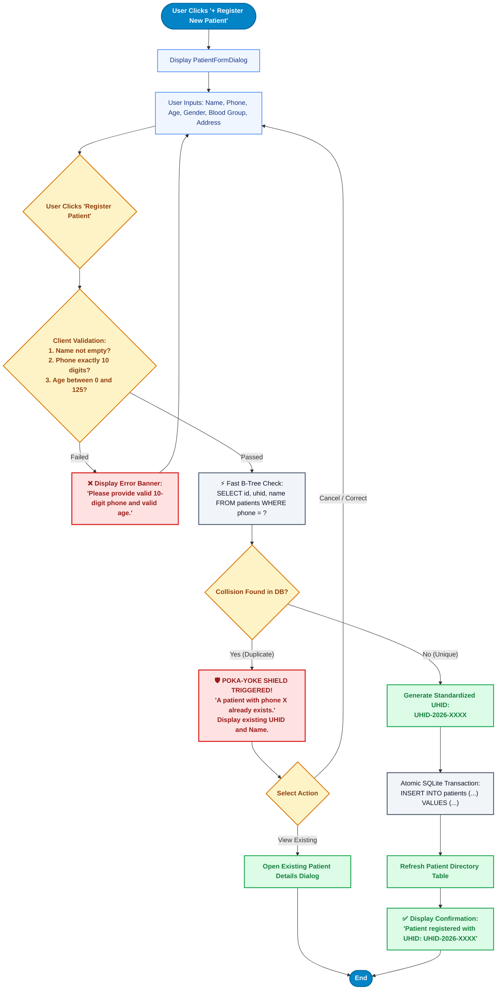
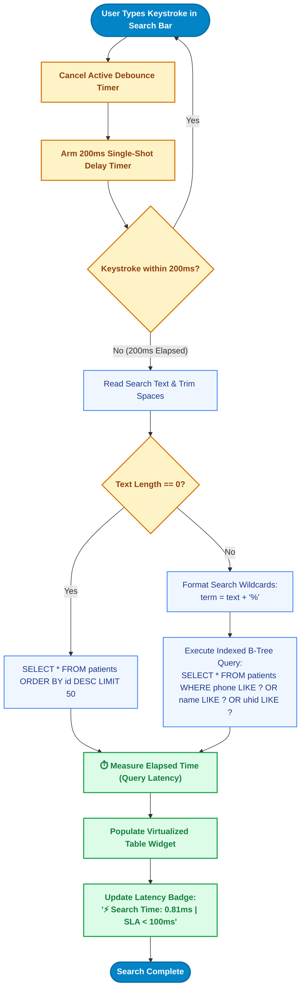
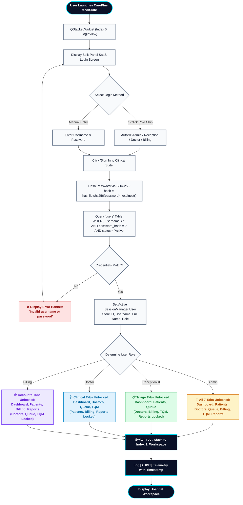

# COMPREHENSIVE PROCESS FLOWCHARTS & SYSTEM WORKFLOWS
## College Course: BBAT104 – Fundamentals of Total Quality Management (TQM)
### Project Title: CarePlus MediSuite — High-Performance Hospital Management System (HMS)
**Focus Area:** Quality Goal Q02 – Improve Performance (Wait-Time Reduction & Duplicate Prevention)

---

### Academic & Student Metadata
* **Student Name:** Bhupinder Singh
* **Roll Number:** 2410301011
* **Course Code & Title:** BBAT104 – Fundamentals of Total Quality Management
* **Department / Class:** Computer Science & Engineering (CSE - A)
* **Assigned Quality Goal:** Q02 – Improve Performance
* **Repository Name:** `BBAT104_TQM_2410301011`
* **Version:** 2.4.0 (PySide6 Modern Clinical SaaS Suite)
* **Date:** October 2026

---

## 1. MASTER END-TO-END PATIENT JOURNEY & CLINICAL QUEUE FLOWCHART

This master flowchart illustrates the complete journey of an outpatient from arrival to billing discharge, structured into color-coded clinical stages with Poka-Yoke error boundaries, queue sequencing, and Deming feedback telemetry.

```mermaid
flowchart TD
    %% Global Class Definitions
    classDef startPill fill:#0284C7,stroke:#0369A1,stroke-width:2.5px,color:#FFFFFF,font-weight:bold;
    classDef endPill fill:#0A1128,stroke:#00E5FF,stroke-width:2.5px,color:#FFFFFF,font-weight:bold;
    classDef decision fill:#FEF3C7,stroke:#D97706,stroke-width:2px,color:#92400E,font-weight:bold;
    classDef alertRed fill:#FEE2E2,stroke:#DC2626,stroke-width:2.5px,color:#991B1B,font-weight:bold;
    classDef successGreen fill:#DCFCE7,stroke:#16A34A,stroke-width:2px,color:#15803D,font-weight:bold;
    classDef searchBlue fill:#E0F2FE,stroke:#0284C7,stroke-width:2px,color:#0369A1,font-weight:bold;
    classDef queueAmber fill:#FFF7ED,stroke:#EA580C,stroke-width:2px,color:#9A3412,font-weight:bold;
    classDef clinicalGreen fill:#F0FDF4,stroke:#22C55E,stroke-width:2px,color:#166534,font-weight:bold;
    classDef billingPurple fill:#F5F3FF,stroke:#8B5CF6,stroke-width:2px,color:#5B21B6,font-weight:bold;
    classDef tqmTeal fill:#CCFBF1,stroke:#0D9488,stroke-width:2.5px,color:#115E59,font-weight:bold;
    classDef dbCylinder fill:#F1F5F9,stroke:#475569,stroke-width:2px,color:#0F172A,font-weight:bold;

    Arrival([🚶 1. Patient Arrives at Reception Desk]):::startPill
    TriageCheck{Is Patient Registered in HMS?}:::decision
    
    subgraph Stage1 ["Stage 1: Registration & Poka-Yoke Triage Verification"]
        NewReg[Fill Demographic Details:<br/>Full Name, Phone, Age, Gender, Address]:::searchBlue
        PokaYoke{"🛡️ Poka-Yoke Duplicate Shield:<br/>Phone 10 Digits & Unique?<br/>Age in [0, 125]?"}:::decision
        DuplicateAlert["⚠️ DUPLICATE COLLISION DETECTED!<br/>Display Existing UHID & Medical Profile"]:::alertRed
        GenUHID["✅ Generate Unique UHID:<br/>UHID-2026-XXXX"]:::successGreen
        SavePatient[(Insert into SQLite 'patients'<br/>Indexed via idx_patients_phone)]:::dbCylinder
        SearchBox[Fast Search by Phone / Name / UHID]:::searchBlue
        FastSearch["⚡ Sub-1ms B-Tree Search<br/>Debounced 200ms Engine"]:::searchBlue
        SelectPatient[Select Verified Patient Record]:::successGreen
    end

    subgraph Stage2 ["Stage 2: Specialist Allocation & OPD Queue Sequencing"]
        SelectDoctor[Select Attending Specialist<br/>from Live Duty Roster]:::clinicalGreen
        CheckRoster{Doctor Status == 'Available'?}:::decision
        RosterWait[Select Alternate Specialist / Wait]:::queueAmber
        IssueToken["🎟️ Issue Sequential OPD Token<br/>e.g., Token #014 (Room 104)"]:::queueAmber
        QueueState["⏳ Patient in Waiting Lounge<br/>Status: 'Waiting' | Telemetry Timer On"]:::queueAmber
    end

    subgraph Stage3 ["Stage 3: Physician Consultation & Clinical Telemetry"]
        CallPatient["📢 Doctor Calls Patient Token<br/>Status: 'In-Consultation'"]:::clinicalGreen
        Examine[Clinical Examination & Vitals Assessment]:::clinicalGreen
        DiagNotes[Enter Clinical Diagnosis & Rx Notes]:::clinicalGreen
        CompleteConsult["✅ Complete Consultation<br/>Status: 'Completed'"]:::successGreen
        WaitTelemetry["⏱️ Compute Wait Time Telemetry:<br/>Wait Time = Call Time - Checkin Time<br/>Log into performance_logs"]:::tqmTeal
    end

    subgraph Stage4 ["Stage 4: Financial Settlement & 5% GST Invoicing"]
        BillingQueue["🧾 Patient Proceeds to Accounts Counter"]:::billingPurple
        ItemizeBill[Itemize Consultation Fee + Lab Tests]:::billingPurple
        ComputeTax["Calculate 5% Healthcare GST<br/>Total = Subtotal + 5% GST"]:::billingPurple
        GenerateInvoice["Generate Formal Invoice<br/>e.g., INV-2026-0008"]:::billingPurple
        PayMethod{Select Payment Mode}:::decision
        CashPay[💵 Cash]:::billingPurple
        UPIPay[📱 UPI / QR Code]:::billingPurple
        CardPay[💳 Credit/Debit Card]:::billingPurple
        InsurancePay[🏥 TPA Insurance Claim]:::billingPurple
        IssueReceipt["🖨️ Issue Itemized Tax Receipt<br/>with Official Hospital Stamp"]:::successGreen
    end

    Discharge([🏁 5. Patient Discharged & Outpatient Flow Completed]):::endPill
    TQMAudit["📊 TQM Deming Continuous Feedback Audit:<br/>• OPD Wait Time SLA Compliance (< 15 min)<br/>• Real-Time Pareto Defect Frequency Check<br/>• Zero Duplicate UHID Guarantee"]:::tqmTeal

    %% Stage 1 Routing
    Arrival --> TriageCheck
    TriageCheck -- "No (New Patient)" --> NewReg
    NewReg --> PokaYoke
    PokaYoke -- "Collision Detected" --> DuplicateAlert
    DuplicateAlert --> SelectPatient
    PokaYoke -- "Unique & Valid" --> GenUHID
    GenUHID --> SavePatient
    SavePatient --> SelectPatient
    
    TriageCheck -- "Yes (Existing Patient)" --> SearchBox
    SearchBox --> FastSearch
    FastSearch --> SelectPatient
    
    %% Stage 2 Routing
    SelectPatient ==> SelectDoctor
    SelectDoctor --> CheckRoster
    CheckRoster -- "No (Busy / Off-Duty)" --> RosterWait
    RosterWait --> SelectDoctor
    CheckRoster -- "Yes (Available)" --> IssueToken
    IssueToken --> QueueState
    
    %% Stage 3 Routing
    QueueState ==> CallPatient
    CallPatient --> Examine
    Examine --> DiagNotes
    DiagNotes --> CompleteConsult
    CompleteConsult --> WaitTelemetry
    
    %% Stage 4 Routing
    WaitTelemetry ==> BillingQueue
    BillingQueue --> ItemizeBill
    ItemizeBill --> ComputeTax
    ComputeTax --> GenerateInvoice
    GenerateInvoice --> PayMethod
    PayMethod --> CashPay
    PayMethod --> UPIPay
    PayMethod --> CardPay
    PayMethod --> InsurancePay
    CashPay --> IssueReceipt
    UPIPay --> IssueReceipt
    CardPay --> IssueReceipt
    InsurancePay --> IssueReceipt
    
    %% Discharge & TQM Routing
    IssueReceipt ==> Discharge
    Discharge -.-> TQMAudit

    %% Subgraph Styling
    style Stage1 fill:#F8FAFC,stroke:#0284C7,stroke-width:2px;
    style Stage2 fill:#FFFBEB,stroke:#F59E0B,stroke-width:2px;
    style Stage3 fill:#F0FDF4,stroke:#10B981,stroke-width:2px;
    style Stage4 fill:#F5F3FF,stroke:#8B5CF6,stroke-width:2px;
```

---

## 2. 3-TIER SYSTEM ARCHITECTURE FLOWCHART

The CarePlus MediSuite platform is structured into three decoupled layers ensuring sub-millisecond query performance, modular maintainability, and enterprise-grade reliability.

```mermaid
graph TD
    %% Styling Classes
    classDef tierHeader fill:#0A1128,stroke:#00E5FF,stroke-width:2.5px,color:#FFFFFF,font-weight:bold;
    classDef presNode fill:#EFF6FF,stroke:#3B82F6,stroke-width:1.5px,color:#1E3A8A,font-weight:bold;
    classDef logicNode fill:#F0FDF4,stroke:#22C55E,stroke-width:1.5px,color:#166534,font-weight:bold;
    classDef dataNode fill:#FFF7ED,stroke:#EA580C,stroke-width:1.5px,color:#9A3412,font-weight:bold;

    subgraph Tier1 ["Tier 1: Presentation Tier (PySide6 SaaS Modern UI)"]
        UI_Head["🖥️ Client Presentation Layer"]:::tierHeader
        UI_Login["🔐 Split-Panel SaaS Login View<br/>1-Click Role Autofill Chips & SHA-256 Auth"]:::presNode
        UI_Dash["📊 Hospital Operations Dashboard<br/>KPI Cards, Spline Area Charts & Top Doctors"]:::presNode
        UI_Patients["👥 Patient Directory Registry<br/>Instant Debounced Fast Search & Poka-Yoke Form"]:::presNode
        UI_Doctors["👨‍⚕️ Doctor Duty Roster<br/>Live Availability Status Switcher & Profiles"]:::presNode
        UI_Queue["📅 OPD Queue & Tokens View<br/>Sequential Tokens & Consultation Notes Dialog"]:::presNode
        UI_Billing["🧾 Billing & Accounts Settlement<br/>5% GST Itemization & Payment Modal"]:::presNode
        UI_TQM["🎯 TQM Quality & Audits View<br/>PDCA, Pareto 80/20, Fishbone, FMEA, Checksheet"]:::presNode
        UI_Reports["📈 Vectorized Reporting Cockpit<br/>Sub-25ms Pandas Aggregations & CSV Export"]:::presNode
    end

    subgraph Tier2 ["Tier 2: Business Logic & Performance Engine"]
        Logic_Head["⚡ Core Application Services"]:::tierHeader
        Engine_RBAC["Role-Based Access Control (RBAC)<br/>Enforces Admin | Reception | Doctor | Billing Permissions"]:::logicNode
        Engine_Search["Debounced Fast Search Controller<br/>200ms Delay Timer with Zero UI Freezing"]:::logicNode
        Engine_PokaYoke["Poka-Yoke Error Prevention Shield<br/>Phone Number & UHID Collision Interceptor"]:::logicNode
        Engine_Queue["Queue Sequencer & SLA Calculator<br/>Real-Time Wait-Time Telemetry Tracking"]:::logicNode
        Engine_Pandas["Vectorized Analytical Aggregator<br/>In-Memory C-Optimized Pandas Aggregations"]:::logicNode
        Engine_SQC["Statistical Quality Control Visualizer<br/>Matplotlib Vector Canvas Generators"]:::logicNode
    end

    subgraph Tier3 ["Tier 3: Data Persistence Tier (Optimized SQLite Engine)"]
        Data_Head["🗄️ Relational Persistence & Cache"]:::tierHeader
        PRAGMA_WAL["Write-Ahead Logging (WAL)<br/>PRAGMA journal_mode = WAL<br/>PRAGMA synchronous = NORMAL"]:::dataNode
        MemoryCache["64 MB Shared Memory Cache<br/>PRAGMA cache_size = -64000"]:::dataNode
        DB_Core[("SQLite Database File:<br/>hms_database.db")]:::dataNode
        BTree_Idx["10 Composite B-Tree Indexes:<br/>idx_patients_phone, idx_patients_name, idx_patients_uhid,<br/>idx_appointments_date_status, idx_billing_invoice_date..."]:::dataNode
    end

    Tier1 ==> Tier2
    Tier2 ==> Tier3

    style Tier1 fill:#F8FAFC,stroke:#3B82F6,stroke-width:2px;
    style Tier2 fill:#F0FDF4,stroke:#22C55E,stroke-width:2px;
    style Tier3 fill:#FFF7ED,stroke:#EA580C,stroke-width:2px;
```

---

## 3. DEMING PDCA CONTINUOUS IMPROVEMENT QUALITY CYCLE

Quality Goal Q02 (Improve Performance) follows W. Edwards Deming’s continuous Kaizen loop:

```mermaid
flowchart TD
    classDef planBox fill:#EFF6FF,stroke:#3B82F6,stroke-width:2px,color:#1E3A8A,font-weight:bold;
    classDef doBox fill:#FEF3C7,stroke:#D97706,stroke-width:2px,color:#92400E,font-weight:bold;
    classDef checkBox fill:#F0FDF4,stroke:#16A34A,stroke-width:2px,color:#166534,font-weight:bold;
    classDef actBox fill:#F5F3FF,stroke:#8B5CF6,stroke-width:2px,color:#5B21B6,font-weight:bold;

    subgraph Plan_Phase ["1. PLAN (Problem Identification & Root-Cause Analysis)"]
        P1["Identify Healthcare Bottlenecks:<br/>- Registration queue delays (45-90s per patient)<br/>- Duplicate patient records causing clinical errors<br/>- Dashboard freeze on large datasets"]:::planBox
        P2["Voice of Customer (VOC) Mapping:<br/>Target SLA: Wait Time < 15 min, Search < 100ms"]:::planBox
        P3["Ishikawa 4-M/P Root Cause Analysis:<br/>Isolate missing DB indexes, unbuffered UI thread"]:::planBox
        P4["FMEA Risk Prioritization:<br/>Baseline Highest Pre-RPN = 168 (Slow Search)"]:::planBox
    end

    subgraph Do_Phase ["2. DO (Engineering Implementation & Quality Controls)"]
        D1["Implement SQLite Write-Ahead Logging (WAL)<br/>and 10 Composite B-Tree Indexes"]:::doBox
        D2["Engineer Poka-Yoke Phone & UHID Collision Shield"]:::doBox
        D3["Implement 200ms Debounced Fast Search-as-you-type"]:::doBox
        D4["Build Vectorized Pandas Reporting Engine (< 25ms SLA)"]:::doBox
        D5["Deploy Modern PySide6 SaaS Interface with RBAC"]:::doBox
    end

    subgraph Check_Phase ["3. CHECK (Measurement, SQC & Statistical Verification)"]
        C1["Log all operational latencies into 'performance_logs'"]:::checkBox
        C2["Execute Pareto 80/20 Defect Frequency Analysis"]:::checkBox
        C3["Recalculate Post-FMEA RPN Matrix:<br/>Highest RPN drops from 168 -> 18 (90.2% reduction)"]:::checkBox
        C4["Record Kaizen Checksheet Incidents in Real Time"]:::checkBox
        C5["Run Comprehensive 10-Stage Test Harness (100% Pass)"]:::checkBox
    end

    subgraph Act_Phase ["4. ACT (Standardization & Institutional Kaizen)"]
        A1["Standardize Sub-1ms Query SLA as Hospital Baseline"]:::actBox
        A2["Lock Poka-Yoke Validation Shield into all Entry Dialogs"]:::actBox
        A3["Deploy Daily 1-Click Vectorized OPD Summary Audits"]:::actBox
        A4["Archive Evaluation Artifacts for BBAT104 Accreditation"]:::actBox
    end

    Plan_Phase ==> Do_Phase
    Do_Phase ==> Check_Phase
    Check_Phase ==> Act_Phase
    Act_Phase ==> Plan_Phase

    style Plan_Phase fill:#F0F9FF,stroke:#3B82F6,stroke-width:2px;
    style Do_Phase fill:#FFFBEB,stroke:#D97706,stroke-width:2px;
    style Check_Phase fill:#F0FDF4,stroke:#16A34A,stroke-width:2px;
    style Act_Phase fill:#FAF5FF,stroke:#8B5CF6,stroke-width:2px;
```

---

## 4. POKA-YOKE (MISTAKE-PROOFING) REGISTRATION FLOWCHART

---

## 5. FAST SEARCH-AS-YOU-TYPE ENGINE FLOWCHART (SUB-100MS SLA)

---

## 6. ROLE-BASED ACCESS CONTROL (RBAC) SECURITY FLOWCHART

---

## 7. FINANCIAL SETTLEMENT & 5% GST ITEMIZATION FLOWCHART

```mermaid
flowchart TD
    classDef startPill fill:#0284C7,stroke:#0369A1,stroke-width:2px,color:#FFFFFF,font-weight:bold;
    classDef purpleStep fill:#F5F3FF,stroke:#8B5CF6,stroke-width:1.5px,color:#5B21B6;
    classDef decision fill:#FEF3C7,stroke:#D97706,stroke-width:2px,color:#92400E,font-weight:bold;
    classDef greenSuccess fill:#DCFCE7,stroke:#16A34A,stroke-width:2px,color:#15803D,font-weight:bold;

    ConsultDone([Consultation Completed]):::startPill --> OpenBilling[Open Billing & Invoicing Panel]:::purpleStep
    OpenBilling --> SelectAppt[Select Completed Appointment Token]:::purpleStep
    
    SelectAppt --> CalcBase[Retrieve Consultation Fee: ₹500 - ₹1500]:::purpleStep
    CalcBase --> AddServices[Add Diagnostic Tests / Bed Charges]:::purpleStep
    AddServices --> ComputeGST["Compute Statutory 5% Healthcare GST:<br/>GST Amount = Subtotal × 0.05<br/>Total Bill = Subtotal + GST Amount"]:::purpleStep
    
    ComputeGST --> CreateInv["Generate Invoice in SQLite 'billing' Table:<br/>Status = 'Pending'"]:::purpleStep
    CreateInv --> SettlePrompt{User Clicks 'Settle Invoice'}:::decision
    
    SettlePrompt --> OpenPayModal[Launch PaymentSettlementDialog]:::purpleStep
    OpenPayModal --> ChooseMethod["Select Mode: Cash / UPI / Card / Insurance"]:::decision
    ChooseMethod --> ConfirmPay[Click 'Confirm & Record Payment']:::purpleStep
    
    ConfirmPay --> AtomicUpdate["Atomic SQLite Transaction:<br/>UPDATE billing SET status = 'Paid', amount_paid = total<br/>WHERE id = ?"]:::greenSuccess
    AtomicUpdate --> LaunchReceipt[Launch InvoiceReceiptDialog]:::greenSuccess
    LaunchReceipt --> RenderTaxReceipt["Display Itemized Tax Invoice:<br/>- Invoice No & UHID<br/>- Base Charges & 5% GST Breakdown<br/>- Official Hospital Stamp & Signature"]:::greenSuccess
    RenderTaxReceipt --> PrintOrClose[Print / Export CSV / Close]:::greenSuccess
    PrintOrClose --> SettleDone([Financial Settlement Completed]):::startPill
```

---

## 8. FMEA RISK MITIGATION & DEFECT PREVENTION FLOWCHART

```mermaid
flowchart TD
    classDef startPill fill:#0A1128,stroke:#00E5FF,stroke-width:2.5px,color:#FFFFFF,font-weight:bold;
    classDef redRisk fill:#FEE2E2,stroke:#DC2626,stroke-width:2px,color:#991B1B,font-weight:bold;
    classDef blueCtrl fill:#EFF6FF,stroke:#3B82F6,stroke-width:1.5px,color:#1E3A8A,font-weight:bold;
    classDef greenRes fill:#DCFCE7,stroke:#16A34A,stroke-width:2px,color:#15803D,font-weight:bold;

    StartFMEA([Initiate Failure Mode & Effects Analysis]):::startPill --> IdentifyModes["Identify 6 Potential Failure Modes:<br/>1. Slow Patient Search<br/>2. Duplicate Patient Registrations<br/>3. OPD Queue Overcrowding<br/>4. UI Freeze on Report Generation<br/>5. Doctor Assignment Collisions<br/>6. Invoicing Math & Tax Calculation Errors"]:::redRisk
    
    IdentifyModes --> ScoreBaseline["Score Baseline Metrics (Scale 1-10):<br/>RPN = Severity (S) × Occurrence (O) × Detection (D)"]:::redRisk
    ScoreBaseline --> BaselineMatrix["Baseline Pre-RPN Calculations:<br/>• Slow Search: 7 × 8 × 3 = 168 (Highest Risk)<br/>• Duplicate Registrations: 8 × 7 × 2 = 112<br/>• Queue Overcrowding: 6 × 7 × 2 = 84<br/>• UI Freezes: 6 × 6 × 3 = 108<br/>• Doctor Collisions: 5 × 4 × 2 = 40<br/>• Invoicing Errors: 8 × 3 × 1 = 24"]:::redRisk
    
    BaselineMatrix --> ApplyControls["Implement Quality Engineering Controls:<br/>1. Composite B-Tree Indexes & SQLite WAL Mode<br/>2. Poka-Yoke Validation Shield on Phone & UHID<br/>3. Automated Sequential Token Queue & Wait-Time Tracker<br/>4. Vectorized In-Memory Pandas Aggregations<br/>5. Live Roster Status Toggle<br/>6. Automated 5% GST Formula Calculation"]:::blueCtrl
    
    ApplyControls --> RescorePost["Rescore Post-Improvement Metrics (S × O × D)"]:::blueCtrl
    RescorePost --> PostMatrix["Post-Improvement Post-RPN Results:<br/>• Slow Search: 7 × 1 × 1 = 7 (95.8% drop)<br/>• Duplicate Registrations: 8 × 1 × 1 = 8 (92.8% drop)<br/>• Queue Overcrowding: 6 × 2 × 1 = 12 (85.7% drop)<br/>• UI Freezes: 6 × 1 × 1 = 6 (94.4% drop)<br/>• Doctor Collisions: 5 × 1 × 1 = 5 (87.5% drop)<br/>• Invoicing Errors: 8 × 1 × 1 = 8 (66.7% drop)"]:::greenRes
    
    PostMatrix --> CalculateReduction["Overall Defect Risk Reduction:<br/>Total Pre-RPN: 536 ➔ Total Post-RPN: 46<br/>Cumulative Defect Mitigation = 91.4%"]:::greenRes
    CalculateReduction --> ConcludeFMEA([FMEA Target Achieved & Verified]):::startPill
```

