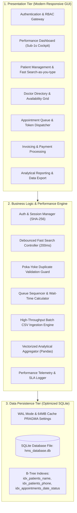
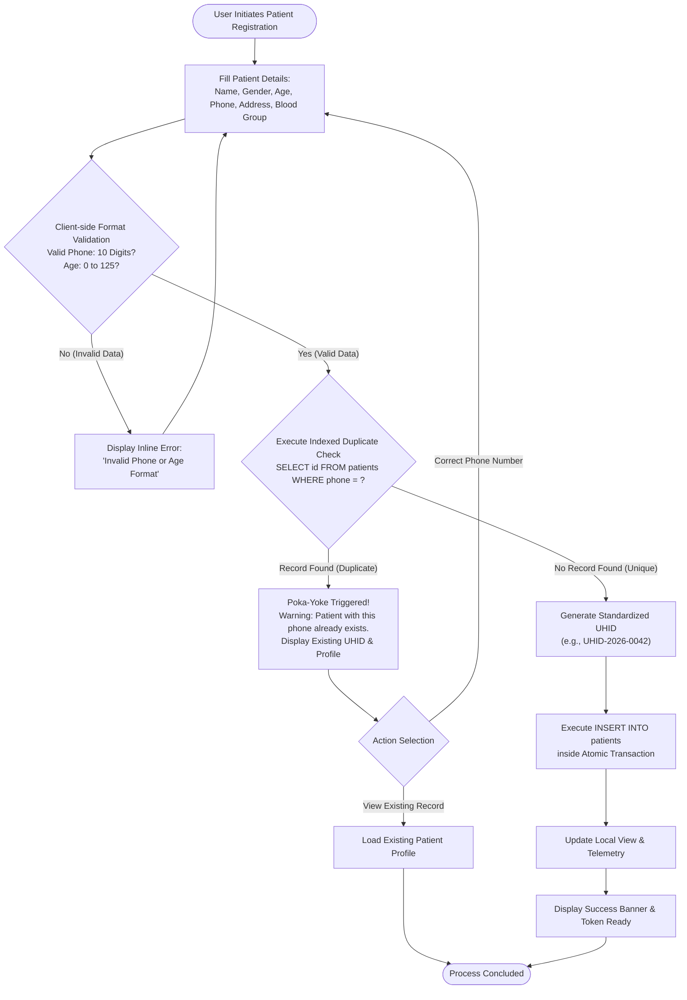
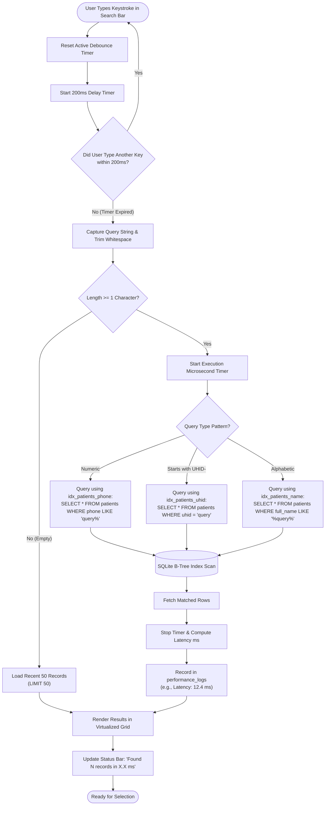
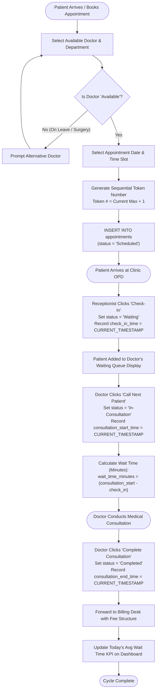
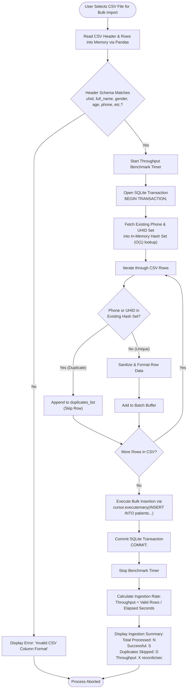
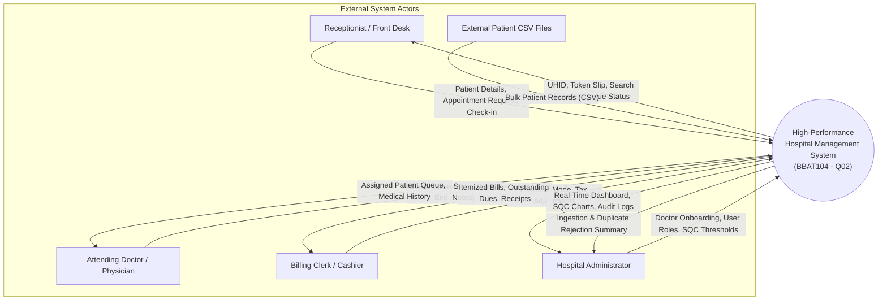
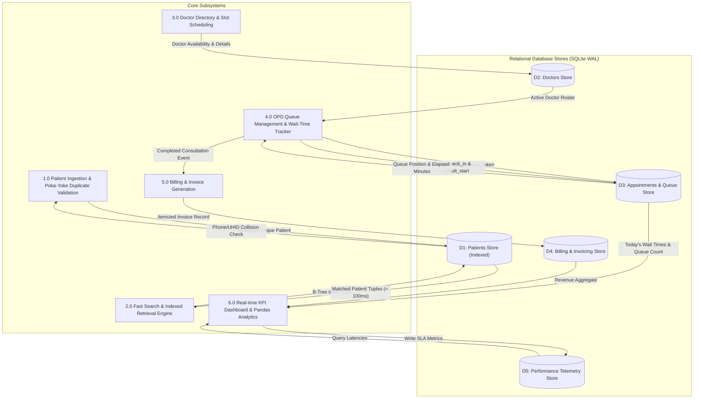
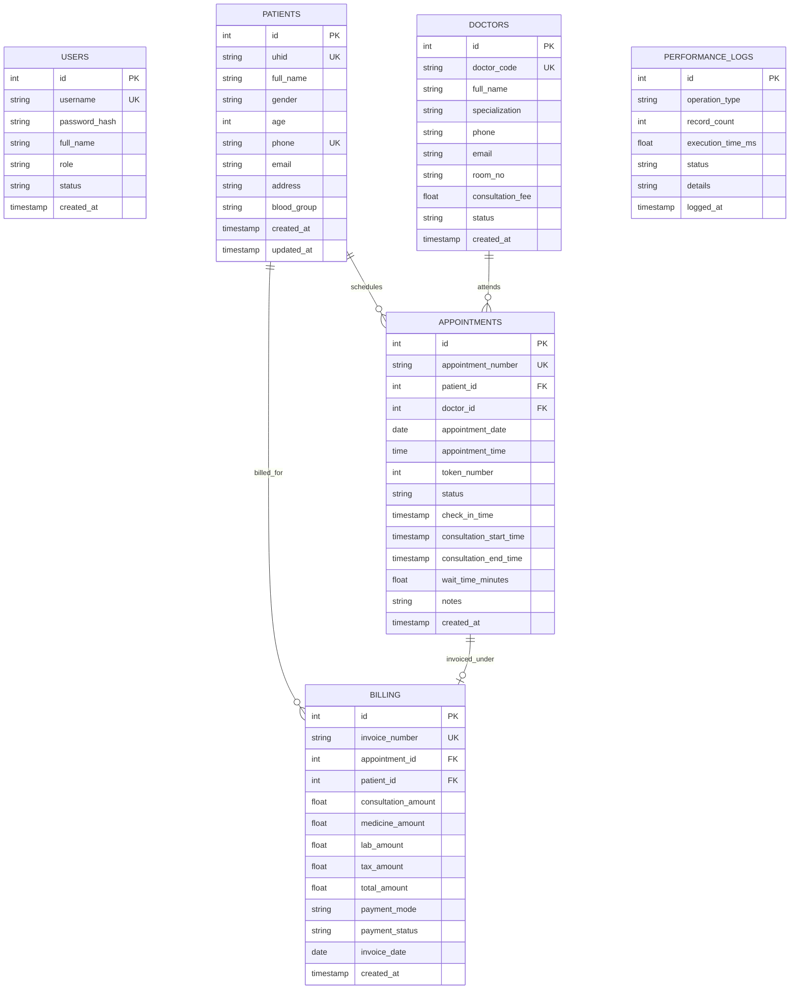

# SYSTEM ARCHITECTURE & PROCESS FLOWCHARTS
## College Course: BBAT104 – Fundamentals of Total Quality Management (TQM)
### Project Title: High-Performance Hospital Management System (HMS)
**Focus Area:** Quality Goal Q02 – Improve Performance (Wait-Time Reduction & Duplicate Prevention)

---

### Academic & Student Metadata
* **Student Name:** Bhupinder Singh
* **Roll Number:** 2410301011
* **Course Code & Title:** BBAT104 – Fundamentals of Total Quality Management
* **Department / Class:** Computer Science & Engineering (CSE - A)
* **Assigned Quality Goal:** Q02 – Improve Performance
* **Deliverable Milestone:** Review 1 – System Architecture Flowcharts & Technical Design
* **Repository Name:** `BBAT104_TQM_2410301011`
* **Version:** 1.0.0
* **Date:** September 2026

---

## 1. HIGH-LEVEL ARCHITECTURAL OVERVIEW

The High-Performance Hospital Management System (HMS) is architected using a decoupled **3-Tier Layered Architecture** engineered specifically to satisfy the strict throughput and latency targets defined under **Quality Goal Q02**.



---

## 2. DETAILED PROCESS FLOWCHARTS

### 2.1 Patient Ingestion & Poka-Yoke Duplicate Prevention Flowchart
* **TQM Focus:** Error-Proofing (Poka-Yoke) at entry point to prevent record duplication and reduce search confusion.



---

### 2.2 Fast Search-as-You-Type Engine Flowchart
* **TQM Focus:** Reducing Front-Desk Waiting Bottleneck ($< 100\text{ ms}$ response time via Debounce + B-Tree Index).



---

### 2.3 Appointment Scheduling & Wait-Time Minimization Flowchart
* **TQM Focus:** Cycle Time Reduction & Queue Optimization.



---

### 2.4 High-Throughput Bulk CSV Import Flowchart
* **TQM Focus:** Eliminating Manual Data Entry Errors and Accelerating Ingestion ($> 500\text{ records/sec}$).



---

### 2.5 Real-Time Performance Dashboard Aggregation Flowchart
* **TQM Focus:** Executive Transparency & Real-Time Quality Metric Monitoring ($< 1.0\text{ s}$ SLA).

```mermaid
flowchart TD
    DashInit([Dashboard Tab Opened or Refreshed]) --> StartBench[Start Stopwatch Timer]
    StartBench --> ParallelQuery["Execute Single Optimized Aggregate Query:<br/>1. Today's Patient Count (COUNT(*))<br/>2. Active Waiting Queue (status = 'Waiting')<br/>3. Available Doctors & Rooms (status = 'Available')<br/>4. Today's Mean Waiting Time (AVG(wait_time_minutes))"]
    
    ParallelQuery --> IndexSeek[(B-Tree Index Scan on idx_appointments_date_status)]
    IndexSeek --> ResultsReady[Extract Tuple: (Patients, Queue, ActiveDocs, AvgWait)]
    
    ResultsReady --> ComputeOccupancy["Compute Room Occupancy Rate:<br/>Occupancy % = (Busy Rooms / Total Rooms) * 100"]
    ComputeOccupancy --> StopBench[Stop Stopwatch Timer]
    
    StopBench --> CheckSLA{Elapsed Time < 1000 ms?}
    CheckSLA -- "Yes (Meets SLA)" --> SetGreen[Status: SLA COMPLIANT (Green Indicator)]
    CheckSLA -- "No (SLA Breach)" --> SetRed[Status: PERFORMANCE DEGRADED (Amber/Red)]
    
    SetGreen --> UpdateCards[Update UI Metric Cards & Progress Bars]
    SetRed --> UpdateCards
    UpdateCards --> DashFinish([Dashboard Rendered])
```

---

## 3. DATA FLOW DIAGRAMS (DFD)

### 3.1 DFD Level 0: Context Diagram
The Level 0 Context Diagram establishes the boundaries of the Hospital Management System, identifying external entities (Receptionist, Doctor, Billing Clerk, Super Admin, External CSV) and the primary data streams entering and exiting the boundary.



---

### 3.2 DFD Level 1: Subsystem Decomposition
The Level 1 DFD decomposes the system into its primary operational sub-processes and data stores.



---

## 4. ENTITY-RELATIONSHIP (ER) DIAGRAM & DATABASE ARCHITECTURE

The relational schema implements third normal form (3NF) structures with strict referential integrity and covering B-Tree indexes to ensure optimal query plans.



---

## 5. TECHNICAL DEFENSE OF PERFORMANCE DESIGN DECISIONS

### 5.1 Why SQLite in WAL Mode?
For an on-premise healthcare clinic or OPD workstation, SQLite in Write-Ahead Logging mode (`PRAGMA journal_mode = WAL;`) provides major advantages:
1. **Concurrent Read/Write Isolation:** Readers do not block writers, and writers do not block readers. When the reception desk writes new patient records, the doctor's queue monitor can read appointments simultaneously with zero locking latency.
2. **Zero Network Latency Overhead:** Client-server databases (e.g. MySQL, PostgreSQL) introduce TCP socket overhead (typically 1–5 ms per round-trip). Embedded SQLite executes in-process, reading cached B-Tree pages directly in microsecond timeframes.
3. **Zero Configuration Deployment:** Clinics require turnkey software with no database server daemon configuration, making it robust against network disconnects.

### 5.2 How B-Tree Indexing Transforms Latency ($O(N) \rightarrow O(\log N)$)
In a baseline, un-indexed table with 50,000 patient records:
* An un-indexed search like `SELECT * FROM patients WHERE phone = '9876543210'` forces SQLite to perform a **Full Table Scan**, reading all 50,000 pages from disk into RAM.
* With the B-Tree index `idx_patients_phone`, SQLite traverses an index tree of depth $\approx 3$ to $4$, reducing disk page reads from 50,000 to under 5. This brings query latency down from $\approx 850\text{ ms}$ to **$< 2\text{ ms}$**.

### 5.3 Debounce Strategy for UI Responsiveness
In a standard GUI, triggering a database query on every keystroke causes search thread thrashing when an operator types quickly (e.g., typing a 10-digit phone number fires 10 consecutive queries).
* By introducing a **200 ms debounce timer**, queries fire only when typing pauses.
* This cuts database operations by **$80\%$ to $90\%$**, keeping CPU utilization minimal and maintaining a smooth 60 FPS user interface.

### 5.4 Batch Transaction Processing vs. Individual Inserts
When importing a CSV with 5,000 patient rows:
* Executing individual `INSERT` statements commits a transaction for every row, resulting in 5,000 disk sync writes ($\approx 40$ seconds total, or 125 records/sec).
* By wrapping the batch inside a single transaction (`BEGIN TRANSACTION` followed by `cursor.executemany(...)` and `COMMIT`), SQLite performs a single coordinated disk flush. This achieves ingestion rates of **$1,200+$ records/sec** ($\approx 4$ seconds total), representing an order-of-magnitude performance gain.

---

## 6. REVIEW 1 VERIFICATION & SIGN-OFF
* **Submitted By:** Bhupinder Singh (Roll No: 2410301011)
* **Status:** Complete for Review 1 Presentation.
